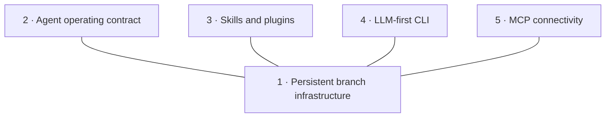

# Branch-Native Agent Infrastructure (BNAI)

**An architectural methodology for persistent, composable agent engineering.**

BNAI teaches humans and AI agents how to build project-bound engineering infrastructure in durable version-control branches. Preserve context across sessions, select only the capabilities needed, and verify work against exact revisions — without requiring a particular model, harness or execution provider.

**Specification:** v0.0.0.3.2 candidate · [Version history](CHANGELOG.md) · [PolyForm Strict 1.0.0](LICENSE) · [Reuse terms](NOTICE.md)

[Read the specification](docs/README.md) · [Review a project with BNAI](AGENTS.md) · [Explore source examples](examples/README.md)

## The architecture



Layer 1 is required; each of Layers 2–5 is independently optional. Lines show possible composition, not dependency order. Execution, security and evidence apply across the selected layers.

| Layer | Responsibility |
|---|---|
| [1 · Persistent branch infrastructure](docs/layers/01-persistent-branch.md) | Source, installation, state, tests and evidence |
| [2 · Agent operating contract](docs/layers/02-agent-contract.md) | Identity, authority, procedures and recovery |
| [3 · Skills and plugins](docs/layers/03-skills-plugins.md) | Specialist knowledge and distribution |
| [4 · LLM-first CLI](docs/layers/04-cli.md) | Bounded mechanical commands and structured results |
| [5 · MCP connectivity](docs/layers/05-mcp.md) | Typed tools and contextual resources |

Use Layer 1 alone, 1 + 3, 1 + 2 + 4, or any of the [16 possible compositions](docs/composition.md). Minimal identity, authority and recoverability still apply without a dedicated Layer 2. Standard public GitHub-hosted runners are the primary qualification profile; [private, local, cloud and runner-free options](docs/execution.md) are independent of layer selection.

## Start here

| Reader goal | Route |
|---|---|
| Understand the category | [Definition and scope](docs/definition.md) |
| Design an installation | [Design methodology](docs/methodology.md) and [layer composition](docs/composition.md) |
| Build or maintain a layer | [Implementation and lifecycle guides](docs/README.md) |
| Review a project with an agent | [Agent instructions](AGENTS.md) and [review workflow](WORKFLOW.md) |
| Check laws, evidence or examples | [Standard](STANDARD.md), [acceptance gates](GATE.md), [qualification journeys](docs/qualification-journeys.md), [examples](examples/README.md) |
| Understand or propose changes | [Documentation strategy](docs/documentation-strategy.md), [contribution rules](CONTRIBUTING.md) |

## BNAI Mode

Prerequisites: a compatible agent with authorized read access to this reference and the target repository, and a known target repository/branch. No installation, local shell or runner is needed for an advisory review. Read [AGENTS.md](AGENTS.md) first.

Copy this instruction into the agent (replace OWNER/REPO and BRANCH):

```text
Use BNAI to review OWNER/REPO at BRANCH.
Read https://github.com/vixttha/BNAI-Branch-native-agent-infrastructure
at an exact main-branch revision. Follow AGENTS.md.
Read-only; report reference and target revisions, detected layers,
findings, evidence, untested claims and owner decisions.
```

Expected first result: the agent identifies both full commit revisions, states read-only scope, then maps observed capabilities to the layers. A successful report includes reference and target SHAs, scope, permissions, selected composition, execution profile, evidence, findings and validation limitations. If either revision or required instructions cannot be recovered, report the blocker instead of guessing; see [activation and recovery](AGENTS.md) and [lifecycle](LIFECYCLE.md).

The review loop is **Head → Worker → Validate → Internal Auditor → Head**. Say `Turn BNAI off` to end the role. `$BNAI` is shorthand for explicit intent, not a universally registered command. The owner retains approval authority; instructions cannot grant permissions. See [standard](STANDARD.md) and [gates](GATE.md).

## Scope and evidence

BNAI is a reference specification, not an adopter installation, agent harness, runtime, certification body or mandatory product. Converium is an independent ecosystem of examples. Do not install BNAI into itself or a project to consult this reference.

| Evidence | Scope |
|---|---|
| [Source observations](examples/README.md) | Exact historical source revisions; not runtime qualification |
| [Structural checks](scripts/check_foundation.py) | Intended documentation checks; consult actual runs |
| [GitHub Actions runs](https://github.com/vixttha/BNAI-Branch-native-agent-infrastructure/actions) | Check exact candidate or main revision and outcome |
| [Development and exploratory review](docs/qualification/v0.0.0.3.2/README.md) | Reference observations retained; formal agent trials deferred and unexecuted; no interoperability claim |

This is an evolving candidate, not a formal released standard. Develop the methodology first; use scoped exploratory feedback to discover gaps, and reserve formal behavioral and adopter qualification for mature, explicitly selected capabilities. See [development and evidence stages](docs/methodology.md#development-and-evidence-stages). [Primary sources](docs/sources.md) · [Security](SECURITY.md) · [Contribute](CONTRIBUTING.md).

## Cite this reference

Use the title *Branch-Native Agent Infrastructure (BNAI)*, the version in [VERSION](VERSION), the full commit SHA actually consulted and its commit-pinned repository URL. No DOI, personal author identity, or formal release is asserted. For reuse, read [LICENSE](LICENSE) and [NOTICE.md](NOTICE.md); source-available does not mean open source.
