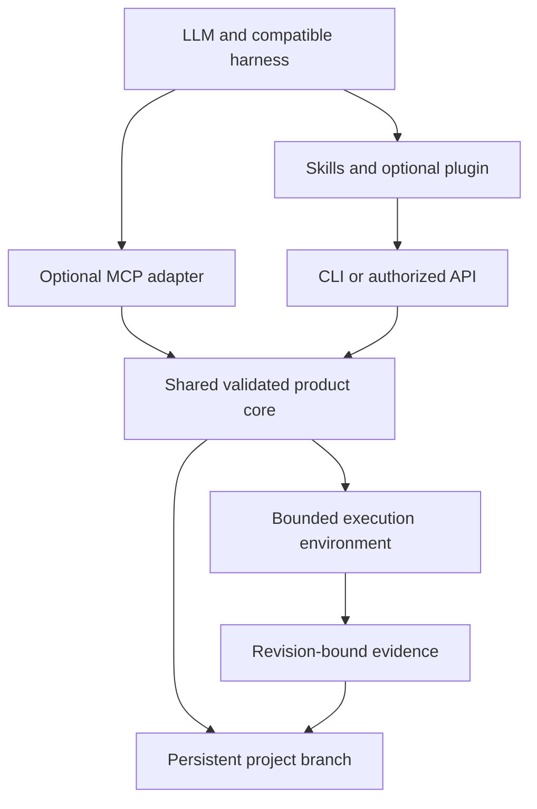

# Four-layer reference architecture

| Layer | Responsibility | Requirement |
|---|---|---|
| 1. Permanent branch | Identity, versioned implementation, adopter state, tests and evidence | Foundation; must operate without requiring the optional layers |
| 2. Skills and plugin packaging | Portable instructions and host-specific distribution | Optional enhancement; native skills can be used without a plugin |
| 3. LLM-first CLI | Discoverable mechanical operations and structured results | Recommended interface; alternatives can qualify |
| 4. MCP | Typed tools, resources and optional prompts for compatible hosts | Optional connectivity; not a trust grant |

CLI and MCP should call a common validated core where practical, rather than duplicating rules. Skills teach safe usage; they do not grant permissions. No universal invocation syntax is assumed. Host-specific packaging must be tested.

## Session synchronization
Resolve authorized repository and installation branch; pin source and state revisions; read identity, permissions, capabilities and current handoff; validate operation scope; execute; verify and reconcile evidence. Refresh after interruptions or changed revisions. Treat branch content as untrusted input until provenance and authority are checked. No instruction overrides host or owner security policies.

## Execution profiles

Public: standard GitHub-hosted runners for public fixtures and permitted public tasks. Private: isolated authorized compute within account allowances and cost ceilings; never publish private data or secrets to obtain free compute. Local: optional execution on compatible hardware. GitHub Actions jobs are ephemeral, not permanent MCP hosting. A remote MCP server needs separately qualified hosting, authentication and isolation. No mandatory model API or hosting subscription.

## LLM-first CLI direction
Use machine-readable discovery and stable structured success/error schemas, meaningful exit codes, bounded noninteractive execution, explicit targets, no implicit overwrite, dry-run where meaningful, revision checks, and exact evidence. See [BART issue #117](https://github.com/vixttha/Blender-Agent-Refinement-Toolkit/issues/117) for a concrete proposed engineering contract. These are guidance, not commands already implemented in all products.
