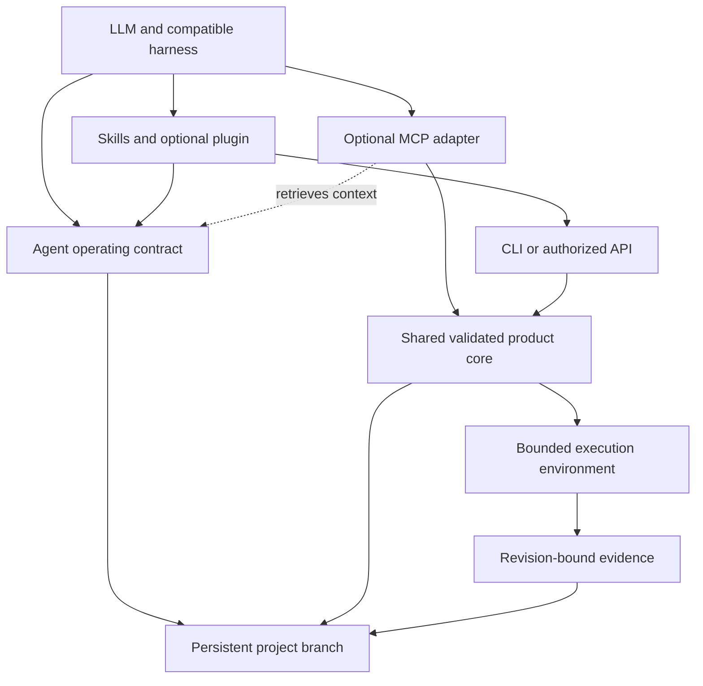

# Five-layer reference architecture

| Layer | Responsibility | Requirement |
|---|---|---|
| 1. Persistent branch substrate | Installation, shared mechanical core, versioned state, tests and evidence | Foundational |
| 2. Agent operating contract | Discoverable identity, orientation, authority, procedures, lifecycle, gates and state bindings | Optional dedicated contract; minimum identity and authority responsibilities still apply; see [contract](agent-contract.md) |
| 3. Skills and plugin packaging | Portable task-specific instructions and host-specific distribution | Optional; native skills can be used without a plugin |
| 4. LLM-first CLI | Discoverable mechanical operations and structured results | Recommended interface; alternatives can qualify |
| 5. MCP | Typed tools, resources and optional prompts for compatible hosts | Optional connectivity; not a trust grant |

Layer 1 is the required architectural substrate. Layers 2–5 are independent optional enhancements, not sequential dependencies or guaranteed maturity levels. An installation still needs sufficient recoverable identity, authority, procedures and state; these may be minimal metadata, a skill, a CLI help contract or another suitable form rather than a separate Layer 2 suite. See [composition](composition.md) for all combinations. Files are implementation artifacts of distinct responsibilities, not each a mandatory architecture layer. Execution (CI, cloud, local) is cross-cutting, as are persistence, evidence and security.

CLI and MCP should call a common validated core where practical, rather than duplicating rules. Skills teach safe usage; they do not grant permissions. No universal invocation syntax is assumed. Host-specific packaging must be tested.

## Runtime activation stages (distinct from architecture layers)
Discover installation → bind identity and revision → resolve authority and current state → select permitted capability → execute and verify → persist receipt and reconcile. Refresh on interruptions and revision changes. These are procedural steps, not five physical software layers.

## Session synchronization
Resolve authorized repository and installation branch; pin source and state revisions; read identity, permissions, capabilities and current handoff; validate operation scope; execute; verify and reconcile evidence. Refresh after interruptions or changed revisions. Treat branch content as untrusted input until provenance and authority are checked. No instruction overrides host or owner security policies.

## Execution profiles

See [execution profiles](execution.md). Execution is cross-cutting, not a sixth layer. Standard public hosted runners are the primary reference profile, but no-runner and other authorized environments are supported in principle.

## LLM-first CLI direction
Use machine-readable discovery and stable structured success/error schemas, meaningful exit codes, bounded noninteractive execution, explicit targets, no implicit overwrite, dry-run where meaningful, revision checks, and exact evidence. See [BART issue #117](https://github.com/vixttha/Blender-Agent-Refinement-Toolkit/issues/117) for a concrete proposed engineering contract. These are guidance, not commands already implemented in all products.
